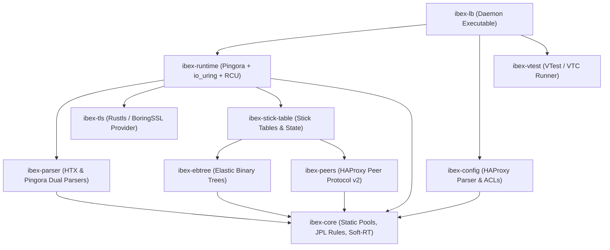

# Project Ibex: Architectural Blueprint & Technical Specification

## 1. Executive Summary & Philosophy

**Project Ibex** is a next-generation, memory-safe, soft-realtime reverse proxy and load balancer written in pure Rust. It is engineered to satisfy modern cybersecurity mandates (such as CISA memory-safety directives) while providing a drop-in migration path from HAProxy via configuration compatibility, stick-table synchronization with existing HAProxy clusters (Peers protocol), and support for HAProxy's `vtest` regression framework.

### Core Engineering Principles
1. **Memory Safety & CISA Compliance**: 100% memory-safe Rust core, eliminating entire classes of buffer overflow, use-after-free, and concurrency vulnerabilities.
2. **Soft-Realtime & NASA JPL Power of 10 Guidelines**: Zero dynamic heap allocations after initialization (JPL Rule 3), bounded execution loops with static upper bounds (JPL Rule 2), high assertion density (JPL Rule 5), and deterministic execution latency.
3. **Aerospace Quality & MC/DC Assurance**: Structural coverage tracking targeting Modified Condition / Decision Coverage (DO-178C Level A standard) for critical parsing and routing paths.
4. **HAProxy Ecosystem Interoperability**:
   - HAProxy configuration syntax parser and ACL engine.
   - Elastic Binary Tree (`ebtree`) data structures in safe, cache-friendly Rust.
   - Stick tables with sliding-window rate tracking.
   - HAProxy Peers Protocol (v2.x wire-compatible) for hybrid Ibex + HAProxy deployments.
   - VTest (`.vtc`) test suite compatibility.
5. **Runtime-Swappable Dual HTTP Parsing**:
   - Pure Rust HAProxy HTX (HTTP Transfer eXchange) parser & ring-buffer stream representation.
   - Cloudflare Pingora HTTP parser.
   - Per-request / per-frontend dynamic parser switching at runtime.
6. **Modern High-Performance I/O & Concurrency**:
   - Pingora async engine combined with Linux `io_uring` zero-copy buffer rings.
   - Lock-free Read-Copy-Update (RCU) synchronization (`arc-swap` / epoch tables) for hitless dynamic reconfiguration and routing updates.
   - SIMD-accelerated header tokenization, URI parsing, and prefix matching (SSE4.2/AVX2/NEON).
   - Multi-TLS engine abstraction (Rustls, OpenSSL/BoringSSL, AWS-LC).

---

## 2. Workspace Crate Architecture

### Crate Responsibilities

| Crate | Purpose | Key Features |
| :--- | :--- | :--- |
| **`ibex-core`** | Foundations & Soft-Realtime Primitives | Static memory arenas, fixed-capacity pools, NASA JPL assertion macros, bounded loop helpers, no-panic error models. |
| **`ibex-ebtree`** | Elastic Binary Trees | Pure safe Rust implementation of `eb32`, `eb64`, `ebmb`, `ebst` trees with $O(k)$ bit-index lookup and SIMD prefix scan. |
| **`ibex-stick-table`** | Stick Table Engine | Session tracking, concurrent connection limits, sliding-window rate limiters, integer/string/IP key indexes. |
| **`ibex-peers`** | HAProxy Peer Protocol | Wire-compatible binary sync protocol v2.1, dictionary compression, delta synchronization for hybrid clusters. |
| **`ibex-parser`** | HTX & Pingora Dual Parsers | Rust HTX intermediate representation, Pingora H1/H2 adapter, SIMD scanner, dynamic runtime parser switch. |
| **`ibex-config`** | HAProxy Config AST & Engine | Lexer, parser for `global`, `frontend`, `backend`, `listen`, `peers`, `acl`, `bind`, `use_backend`, validation passes. |
| **`ibex-tls`** | Multi-TLS Engine | Unified `TlsProvider` abstraction for Rustls (memory-safe default) and OpenSSL/BoringSSL (FIPS/hardware crypto). |
| **`ibex-runtime`** | Engine Runtime & I/O | Pingora integration, Linux `io_uring` zero-copy buffer rings, RCU dynamic table reload without worker thread stalls. |
| **`ibex-vtest`** | VTC Regression Suite Runner | Parses and executes HAProxy `.vtc` regression test scripts directly against Ibex. |
| **`ibex-lb`** | Main Ibex Load Balancer Binary | CLI, daemon supervisor, signal handling, graceful reload, configuration compiler. |

---

## 3. NASA JPL "Power of 10" & Soft-Realtime Guidelines

Ibex enforces the following safety rules across all core crates:
1. **Rule 1 (Simple Control Flow)**: No recursion; no indirect function pointer loops.
2. **Rule 2 (Fixed Loop Bounds)**: Every loop has a statically verifiable upper bound (`const MAX_ITER: usize`), enforced via `ibex_core::bounded_loop!`.
3. **Rule 3 (Static Memory Pre-Allocation)**: Zero heap allocation (`malloc`, `Vec::push` reallocation, `Box::new`) on the request forwarding and parsing hot path. All buffers, connection blocks, HTX stream blocks, and stick-table nodes are allocated at boot-time into fixed-size arena slabs.
4. **Rule 4 (Small Modular Functions)**: Maximum function length guideline of $\le 60$ lines.
5. **Rule 5 (High Assertion Density)**: Minimum 2 assertions per non-trivial function using `ibex_assert!` to validate preconditions, invariants, and postconditions in both debug and safety-checked release builds.
6. **Rule 6 (Minimal Scope)**: State declared at smallest possible scope.
7. **Rule 7 (Comprehensive Validation)**: All return values of fallible calls and network I/O are strictly checked; panics are forbidden (`#![deny(clippy::unwrap_used, clippy::expect_used)]` in production code).
8. **Rule 10 (Zero Warnings)**: `#![deny(warnings)]`, strict Clippy pedantic lints.
