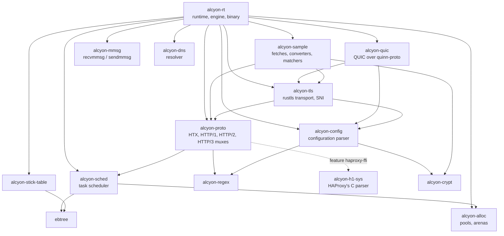

# Alcyon architecture

How Alcyon is put together, as the code stands. Paths are relative to the repository root; the
`design/` and `docs/design/` documents go deeper, but some of them describe plans, and where a
document and the code disagree the code is what runs.

Alcyon follows HAProxy's design where it can: the same configuration language, the same
task-scheduling model, HTX as the internal HTTP representation, and HAProxy's names for most
things. The places it deliberately does something else are in [tradeoff.md](tradeoff.md) and
[docs/differences.md](docs/differences.md).

## Crates

`slz` (deflate, a port of libslz) is a standalone crate with its own tests; nothing uses it yet,
and the `compression` keyword is refused. External crates of note: rustls 0.24 (caller-owned
buffers), quinn-proto (vendored and patched, `vendor/README.md`), regex and fancy-regex, rustix
for system calls, hickory-proto for DNS messages.

## Process model

By default Alcyon is one process. The command line is HAProxy's (`crates/alcyon-rt/src/bin/alcyon.rs`):
`-f` for configuration files, `-c` to check one, `-W` for master-worker mode, `-Ws` to add
systemd notification (`systemd.rs`), `-S` for the master CLI.

- **Master-worker.** With `-W -S`, or `-W` with `user`/`group`/`chroot`, a master process runs no
  proxy and re-executes the binary as its worker (`bin/alcyon/master.rs`). Plain `-W` reloads by
  starting its own successor.
- **Reload without dropping connections.** A new process started with `-x <socket>` asks the old
  one for its listening sockets (`_getsocks`) and receives them as file descriptors over the
  Unix socket: TCP listeners, QUIC and log-forward UDP sockets (`handover.rs`). `-sf` then
  soft-stops the old process.
- **Soft stop** (SIGUSR1, `lifecycle.rs`, `Engine::begin_soft_stop`): listeners close, HTTP/2
  connections get GOAWAY, QUIC connections drain, and `hard-stop-after` bounds the wait.

## Threads

A process runs `nbthread` worker threads (`alcyon-w0`, `alcyon-w1`, ...; by default one per CPU,
at most 64). Only one thread group is supported. Each worker owns an `Engine`
(`crates/alcyon-rt/src/engine.rs`): its own epoll poller (level-triggered, through rustix,
`poller.rs`), file-descriptor table, scheduler, session arena and listening sockets.

- **Connection distribution.** Every worker binds its own `SO_REUSEPORT` socket for each listener
  and the kernel spreads connections among them (`listener.rs`). HAProxy instead accepts on one
  thread and hands connections over; this is a deliberate difference.
- **Shared state.** The compiled proxies (`Arc<Vec<Proxy>>`), with their run-time-mutable values
  in atomics (`proxy_state.rs`, `srv_rt.rs`); stick tables; and the idle server-connection pools,
  one slot per worker, from which another worker may take a connection unless
  `tune.idle-pool.shared off`.
- **Cross-worker requests** (`show sess`, `show quic`, `shutdown session`, ...) go through a
  mailbox per worker, woken by an eventfd (`mailbox.rs`).
- **Other threads:** a watchdog that aborts the process when a worker stops making progress
  (`watchdog.rs`), the log ring and log-forward threads (`ring.rs`, `logfwd.rs`), and the main
  thread, which handles signals and reloads.

## Scheduling

`alcyon-sched` is a HAProxy-style task scheduler, not an async runtime. Tasks are small (32
bytes) and belong to one of five classes with a per-pass budget, so one kind of work cannot starve
another: TLS handshakes, for instance, run in the heaviest class, one per pass. The run queue and
the timer queue are ebtrees, and timers are requeued lazily. A worker's loop polls epoll, wakes
the tasks whose file descriptors are ready or whose timers expired, and runs one scheduler pass
(`Engine::run_loop`, `step_at`); the engine plugs into the scheduler through `Dispatch`
(`EngineDispatcher`).

## Protocol layers

`alcyon-proto` holds the protocol code. Its `lib.rs` describes HAProxy's layering (protocol,
transport, mux, stream endpoint, stream, session); the engine in `alcyon-rt` uses its own
session and stream types over those pieces (`proxy.rs` `TcpSession`, `stream.rs`, the client
transport in `xprt.rs`).

- **HTX** (`htx.rs`) is HAProxy's internal HTTP representation: a message as a sequence of
  typed blocks (start line, headers, data, trailers) in a buffer. Every HTTP version is turned
  into HTX and out of it, so rules and the rest of the engine see one form.
- **HTTP/1:** `h1.rs` (incremental parser), `h1_encode.rs`, `response_head.rs`.
- **HTTP/2:** `h2.rs`, `hpack.rs`, `mux_h2.rs`, and `h2_srv.rs` for connections to servers.
- **HTTP/3:** `h3.rs`, `qpack.rs` (static table), `mux_h3.rs`.
- h2 and h3 streams are bridged into the same HTTP transaction machinery that HTTP/1 uses
  (`crates/alcyon-rt/src/h2_bridge.rs`).

`parser.rs` selects the HTTP/1 parser by name. `h1` is the one built and used. `haproxy-ffi`
(Cargo feature `haproxy-ffi` of alcyon-proto, through `alcyon-h1-sys`, which compiles HAProxy's
own `h1.c` and `http.c`) exists for differential tests. `pingora` is reserved for Pingora's HTTP
parser as a further provider for checking compiler changes; its adapter is not written, and
`htx-flat` (the same grammar over a flat buffer) is not finished either.

## The life of a request

All in `crates/alcyon-rt/src/engine.rs` unless named otherwise.

1. **Accept** (`accept_from_listener`). `tcp-request connection` rules and connection-level
   `track-sc` run here.
2. **TLS**, when the bind has `ssl`: rustls through the client transport (`xprt.rs`), the
   handshake as a scheduler task. The certificate is picked by SNI (`alcyon-tls`, below).
3. **Mux.** HTTP/1 is parsed in place on the session. An HTTP/2 or HTTP/3 connection is an owner
   session whose streams become child sessions (`spawn_h2_children`).
4. **Frontend rules** (`connect_http_backend`): `http-request` rules, then
   `use_backend` / `default_backend` choose the backend, whose own rules run next. Rules, ACLs
   and expressions were compiled once at start (`rule_compiled.rs`).
5. **Server choice** (`route_to_server`, `lb.rs`): roundrobin, static-rr, leastconn, first,
   random, uri, source; cookie persistence (`cookie.rs`); `maxconn` and queueing.
6. **Server connection.** The session's own server connection when it has one, otherwise one
   from the idle pool, otherwise a new connection (HTTP/1, or HTTP/2 with `proto h2`, one stream
   per connection).
7. **Response** (`apply_http_response_rules`): `http-response` rules, then the response goes out
   through the client's mux.
8. **End** (`end_txn`): counters, the log line (`logfmt.rs`, `syslog.rs`), and on HTTP/1
   keep-alive the stream is reset in place for the next request.

`mode tcp` takes the same path without the HTTP steps (`TcpSession`, `tcp-request content`
rules). PROXY protocol v1/v2 (`alcyon-proto/src/proxy_protocol.rs`) and WebSocket upgrades
(`websocket.rs`) are handled along the way.

## Configuration

`alcyon-config` turns the text into an AST: `preproc.rs` (conditional blocks, environment
variables), `lexer.rs`, then `parser::parse_str` (`parser/mod.rs`) into the `Config` types of
`ast/`. Every line goes through `parser/scope.rs` first. A keyword Alcyon does not implement is
refused there with an error naming it (Lua, `filter`, `compression`, `use-service`, `peers`,
`cache`, `fcgi-app`, SSL engines and providers), and unimplemented `bind` and `server` options
are refused in their own parsers. Nothing is accepted and ignored.

The runtime compiles the AST once (`Engine::build_shared_state`): it refuses unknown fetches and
converters, builds the `Proxy` structures, compiles rules, ACLs, expressions and log formats, and
applies the TLS crypto provider. Each worker then binds its listeners and builds its TLS state
(`Engine::new_worker`). `alcyon -c` runs the same checks, certificates included, without serving.

## Samples, ACLs and regular expressions

`alcyon-sample` implements HAProxy's sample model: a fetch (`req.hdr(host)`, `src`, ...), a chain
of converters (`lower`, `map`, ...), and a matcher (`-m str`, `beg`, `reg`, `ip`, ...), typed at
every step (`registry.rs`, `expr.rs`, `matcher.rs`, `design/007-sample-lattice.md`). Predefined
ACLs are compiled once (`acls.rs`); map and ACL files are shared by the process and can be changed
from the CLI (`patref.rs`). `alcyon-regex` compiles with `regex` (linear time) and falls back to
`fancy-regex`, with a backtracking limit, only for syntax that needs it; there is no PCRE.

## Stick tables

`alcyon-stick-table`: one table per `stick-table` declaration, shared by all workers behind a
read-write lock, with an ebtree index and LRU eviction. `track-sc*`, `sc_*` fetches and the
`show table` / `clear table` commands work on it. Tables are not synchronised between processes:
`peers` is refused.

## TLS

`alcyon-tls` runs rustls 0.24 over buffers the caller owns. Certificates come from `bind ... ssl
crt`, and SNI selects among them by exact and wildcard name (`resolver.rs`). The crypto provider
is ring by default; `tune.alcyon.crypto-provider ring-alcyon` selects the vendored zeroizing fork
(`vendor/ringalcyon`), and `set ssl crypto-provider` changes it at run time for new handshakes.
There is no kernel TLS.

## QUIC and HTTP/3

`alcyon-quic` wraps the vendored quinn-proto without doing I/O itself. Each worker has its own
`SO_REUSEPORT` UDP socket (`quic_listener.rs`); datagrams are read with `recvmmsg` and written with
`sendmmsg` in batches of up to 64 (`alcyon-mmsg`, `dgram.rs`). HTTP/3 runs in `mux_h3.rs`
(`tune.alcyon.h3-path mux`, the default); `relay` instead passes the requests to the HTTP/1 path
through a socket pair (`h3_relay.rs`). QUIC connections to servers are not implemented.

## Memory

`alcyon-alloc` provides the two structures caches and spares are built from
(`docs/design/memory-2026-10-24.md`): `Pool<T>`, per-thread free lists under one per-thread byte
budget (`tune.memory.hot-size`), and `Arena<T>`, index-addressed slots sized from `maxconn` for
sessions, applets and tasks. The goal is no heap allocation per request in steady state; test
binaries with a counting global allocator check it (`crates/alcyon-rt/tests/request_allocations.rs`,
`tls_request_allocations.rs`, `request_allocations_h3.rs`). `-m` sets a memory budget the way
HAProxy does (`RLIMIT_DATA`, and `maxconn` derived from it), and `pool_gc.rs` gives cached memory
back. The binary's allocator can zero memory when it is freed (`zero_on_free`).

## Observability and control

- **Stats page** in HTML, CSV and JSON (`stats.rs`, `stats_html.rs`), and a Prometheus exporter
  (`http-request use-service prometheus-exporter`, `promex.rs`).
- **Stats socket CLI** (`applet.rs`): `show info`, `show stat`, `show pools`, `show sess`,
  `show table`, `show servers state`, `show resolvers`, `show quic`, `show errors`, server and
  weight changes, map changes, `clear counters`, `shutdown session`, and the commands reload uses.
  The master CLI is in `bin/alcyon/master.rs`.
- **Logs:** syslog over UDP (RFC 3164), compiled `log-format`s, `ring` sections and
  `log-forward`.

## Other mechanisms

- **Health checks** (`check.rs`): TCP, HTTP and `tcp-check`, run as scheduler tasks; servers can
  `track` another server's state (`track.rs`).
- **DNS** (`alcyon-dns`, `resolvers.rs`): servers named by hostname or SRV record are resolved at
  run time through a `resolvers` section.
- **`server-state-file`** (`server_state.rs`), **global `maxconn`** across workers
  (`globalconn.rs`), and per-thread or shared counters (`tune.alcyon.counters`).
- **Failure:** a panic aborts the process (`crash.rs`); the watchdog aborts it when a worker is
  stuck.

## Testing

What runs where is in [README.md](README.md#how-it-is-tested); the check-in gate is
`tools/checkin.sh`, the HAProxy differential harness is in `harness/`, and the fuzzers are in
`fuzz/`.
