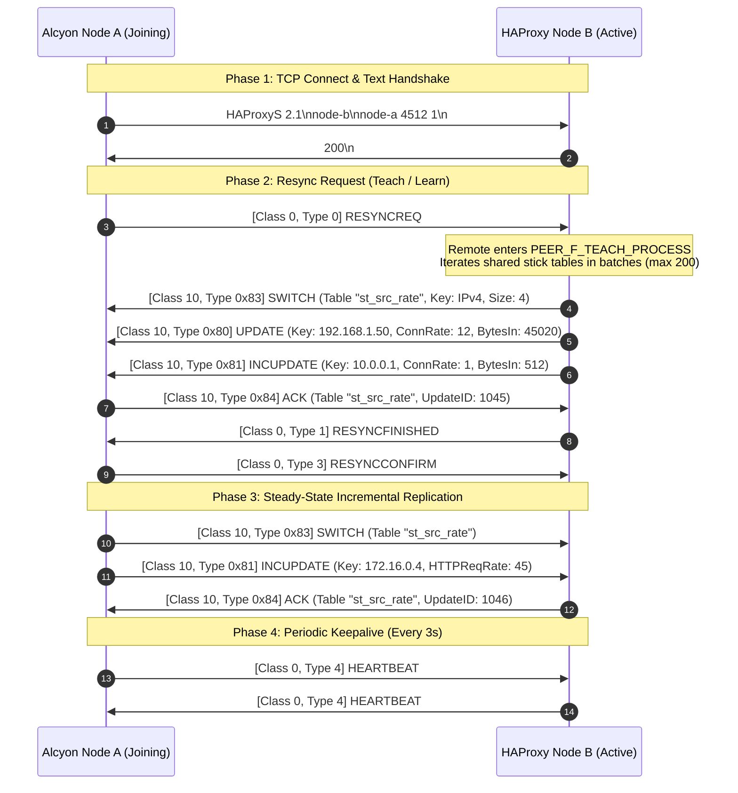

# Alcyon HTTP/2 & Distributed Peers Protocol Architectural Research Report

**Researcher:** Alcyon Protocol & Soft-Realtime Architecture Subagent  
**Reference Codebase:** HAProxy 3.5-dev7 (`/home/bhenc/reference/haproxy` @ `e6f616af`)  
**Target Crates:** `alcyon-proto`, `alcyon-parser`, `alcyon-sched`, `alcyon-stick-table`, `alcyon-peers`, `alcyon-rt`

---

## Executive Summary

This research report provides the technical analysis of HAProxy's HTTP/2 multiplexing architecture (`src/mux_h2.c`, `src/hpack-dec.c`, `src/hpack-enc.c`, `src/hpack-tbl.c`) and distributed stick-table synchronization wire protocol (`src/peers.c`, `include/haproxy/peers-t.h`), and synthesizes the implementation blueprints for **Milestone 5 (HTTP/2 Engine & HPACK)** and **Milestone 6 (Distributed Peers Sync Protocol v2.1)** in Project Alcyon.

All designs adhere to Alcyon’s core architectural tenets:
1. **Zero-heap allocation on the hot path** (NASA JPL Rule 3) via preallocated index arenas and static ring buffers.
2. **Hard thread affinity & lock-free L7 dispatch** (Decision D2).
3. **Bounded execution loops & tree depths** (JPL Rule 2 & ebtree $O(32)$ depth).
4. **Adversarial DoS resilience** (anti-Slowloris lazy timers, HTTP/2 Rapid Reset mitigation, class-budgeted scheduling via `alcyon-sched`).
5. **Bit-for-bit wire compatibility** with HAProxy 2.x/3.x peers and standard HTTP/2 (RFC 7540 / RFC 9113 / RFC 7541 / RFC 8441).

---

## 1. HAProxy HTTP/2 Multiplexing Architecture (`mux_h2.c`)

### 1.1 Connection & Stream Descriptor Hierarchy

In HAProxy's layer model (`design/001-layering.md`), an HTTP/2 connection is managed by `struct h2c`, which multiplexes $N$ concurrent `struct h2s` streams over a single L4/L5 transport `struct connection`.

```
                  +-----------------------------------+
                  |   struct connection (L4/L5 TCP)   |
                  +-----------------+-----------------+
                                    |
                                    v
+-----------------------------------+-----------------------------------+
| struct h2c (Mux H2 Context)                                           |
| - st0: Connection State (H2_CS_*)                                     |
| - mbuf[32]: Mux Output Buffer Ring (br_init)                          |
| - dbuf: Demux Input Buffer                                            |
| - ddht: Demux Dynamic Header Table (hpack_dht)                        |
| - streams_by_id: Elastic Binary Tree (eb32_root)                      |
| - send_list, fctl_list, blocked_list: Intrusive Stream Lists          |
| - task: Connection Idle/Ping Timeout Task                             |
| - wait_event.tasklet: I/O Demux/Mux Tasklet (h2_io_cb)                |
+-----------------------------------+-----------------------------------+
          |                         |                         |
          v                         v                         v
+-------------------+     +-------------------+     +-------------------+
| struct h2s (Stream) |   | struct h2s (Stream) |   | struct h2s (Stream) |
| - id: Stream ID   |     | - id: Stream ID   |     | - id: Stream ID   |
| - st: State (H2_SS)|    | - st: State (H2_SS)|    | - st: State (H2_SS)|
| - sd: struct sedesc|    | - sd: struct sedesc|    | - sd: struct sedesc|
+---------+---------+     +---------+---------+     +---------+---------+
          |                         |                         |
          v                         v                         v
+-------------------+     +-------------------+     +-------------------+
| struct stconn (SC)|     | struct stconn (SC)|     | struct stconn (SC)|
+---------+---------+     +---------+---------+     +---------+---------+
          |                         |                         |
          v                         v                         v
+-------------------+     +-------------------+     +-------------------+
| struct stream     |     | struct stream     |     | struct stream     |
| (L7 Txn / Task)   |     | (L7 Txn / Task)   |     | (L7 Txn / Task)   |
+-------------------+     +-------------------+     +-------------------+
```

#### Upstream Struct Inspection:
- **`struct h2c` (`src/mux_h2.c:47-104`)**:
  - `st0` (`enum h2_cs`): Connection state machine (`H2_CS_PREFACE`, `H2_CS_SETTINGS1`, `H2_CS_FRAME_H`, `H2_CS_FRAME_P`, `H2_CS_FRAME_A`, `H2_CS_FRAME_E`, `H2_CS_ERROR`, `H2_CS_ERROR2`).
  - `mbuf` (`struct buffer mbuf[32]`): Preallocated circular buffer ring for outgoing multiplexed frames.
  - `streams_by_id` (`struct eb_root`): Elastic binary tree indexing active streams by their 31-bit stream ID ($O(32)$ lookup).
  - `send_list`: List of streams with pending data waiting for mux buffer space (`H2_SF_BLK_MROOM`).
  - `fctl_list`: List of streams blocked on connection-level flow control (`H2_SF_BLK_MFCTL`).
  - `blocked_list`: List of streams blocked on stream-level flow control (`H2_SF_BLK_SFCTL`).
  - `shared_rx_bufs`: Bounded shared RX buffer pool (`tune.h2.fe.rxbuf`), preventing malicious clients from forcing per-stream buffer allocation explosion.
- **`struct h2s` (`src/mux_h2.c:108-132`)**:
  - `id` (`int32_t`): HTTP/2 Stream Identifier.
  - `st` (`enum h2_ss`): Stream state machine (`H2_SS_IDLE`, `H2_SS_OPEN`, `H2_SS_HREM`, `H2_SS_HLOC`, `H2_SS_ERROR`, `H2_SS_CLOSED`).
  - `sd` (`struct sedesc *`): The **Stream Endpoint Descriptor** pivot. Bridges `h2s` to `stconn` and the L7 `stream`.
  - `sws` (`int32_t`): Stream window size offset relative to initial window (`miw`).
  - `subs` (`struct wait_event *`): Async wakeup subscription when flow control or buffer space opens.

---

### 1.2 HTTP/2 Connection & Stream State Machines

```
Connection State Machine (h2c->st0):
[PREFACE] ──(Receive Magic Preface)──> [SETTINGS1]
    │                                       │
 (Invalid)                              (Valid SETTINGS)
    │                                       │
    v                                       v
[ERROR / GOAWAY] <───(Frame Err)────── [FRAME_H] (Parse 9-byte Frame Header)
    │                                       │
 [ERROR2] (Close)                           v
                                       [FRAME_P] (Process Payload / Demux)
                                            │
                    ┌───────────────────────┴───────────────────────┐
                    v                                               v
            [FRAME_A] (Send ACK)                            [FRAME_E] (Send RST_STREAM)
                    │                                               │
                    └───────────────────────┬───────────────────────┘
                                            │
                                            v
                                        [FRAME_H] (Loop to next frame)

Stream State Machine (h2s->st):
            [IDLE]
              │ (Receive/Send HEADERS)
              v
            [OPEN] <──────────────────────────────┐
           /      \                               │ (Stream Window Update)
 (Rcv ES) /        \ (Send ES)                    │
         v          v                             │
      [HREM]      [HLOC] ──(Rcv Window Update)───┘
         \          /
 (Send ES)\        / (Rcv ES)
           v      v
           [CLOSED] <─── (Rcv/Send RST_STREAM) ─── [ERROR]
```

---

## 2. Scheduler Mapping, Flow Control & HPACK Bounding

### 2.1 Mapping H2 Streams to `alcyon-sched`

In Alcyon, the threading model is **thread-per-core with hard connection affinity** (`design/002-threading-and-affinity.md`). An entire H2 connection and all its multiplexed child streams execute on a single worker core without cross-thread locking.

```
                      Worker Core RunLoop (alcyon-rt / alcyon-sched)
  ┌─────────────────────────────────────────────────────────────────────────────┐
  │                                                                             │
  │  Epoll Readiness Event ──> h2c I/O Tasklet (Class::Urgent, Weight 64)      │
  │                                    │                                        │
  │                           Demuxes H2 Frames                                 │
  │                                    │                                        │
  │                  ┌─────────────────┴─────────────────┐                      │
  │                  v                                   v                      │
  │         Stream 1 HEADERS                     Stream 3 DATA                  │
  │                  │                                   │                      │
  │      Allocates h2s Arena Slot             Appends to Shared RX Buf          │
  │      Creates Endpoint::Mux(h2s)           Wakes Stream 3 Tasklet            │
  │      Spawns L7 Stream Task                           │                      │
  │                  │                                   v                      │
  │                  v                     Stream 3 Task (Class::Normal, W=60)  │
  │      Stream 1 Task (Class::Normal)     - Executes HTTP analysers            │
  │      - Evaluates ACLs                  - Forwards HTX to Backend            │
  │      - Selects Backend Server          - Decrements Stream Flow Window      │
  │                                                                             │
  └─────────────────────────────────────────────────────────────────────────────┘
```

#### Scheduler Work Unit Mapping:
1. **`H2Connection` I/O Tasklet (`Class::Urgent`, Budget 64)**:
   - Driven by network readiness (`epoll_wait` read/write notifications).
   - Drains raw bytes from `raw_sock` into `dbuf`, validates frame headers, runs HPACK decoding, and routes payloads to target streams.
   - Flushes outgoing `mbuf` frame buffers to transport.
2. **`H2Connection` Timeout Task (`Task` in `Eb32Tree` wait queue)**:
   - Manages connection idle timeouts (`timeout.client`, `timeout.server`, `timeout.clientfin`).
   - Uses **lazy timer requeue** (`design/003-scheduler.md` §4): pushing connection timeouts further out on active frame traffic costs 0 tree modifications.
3. **`H2Stream` L7 Stream Tasks (`Class::Normal`, Budget 60)**:
   - Each stream transaction is represented by an L7 `Stream` owning an `alcyon_sched::TaskId`.
   - Priority handling: HTTP/2 priority flags or stream `nice` settings adjust the run-queue ticket (`rq.key = ticks + nice * RUNQUEUE_DEPTH`), giving strict prioritized execution among concurrent streams.
4. **Self-Waking Streams (`Class::Bulk`, Budget 4)**:
   - Large streaming downloads/uploads pumping buffers through HTX yield after their chunk budget and requeue as `Bulk`, preventing one fast stream from starving other streams on the same connection.

---

### 2.2 Memory Bounding & DDoS Protection

| Attack Vector | Mechanism in HAProxy (`mux_h2.c`) | Alcyon Realization & Soft-RT Bound |
| :--- | :--- | :--- |
| **HTTP/2 Rapid Reset**<br>(CVE-2023-44487) | `h2_fe_max_rst_at_once`, `glitches` counter (`mux_h2.c:498, 3600`) | Bounded RST rate limiter: connections exceeding 100 RST frames per pass without forwarding data trigger `GOAWAY(ENHANCE_YOUR_CALM)` and immediate closure. |
| **Stream Multiplexing Flood** | `streams_hard_limit` (RFC 7540 `SETTINGS_MAX_CONCURRENT_STREAMS = 100`) | Static arena allocation: fixed pool of $N$ `H2Stream` slots per connection. Surplus stream attempts receive `REFUSED_STREAM` or `GOAWAY`. Zero dynamic heap allocation. |
| **HPACK Bomb / Compression Bomb** | `HPACK_ERR_TOO_LARGE` + max header list size (RFC 7540 #6.5.6) | Hard cap on decompressed HTX header size (default 64 KB). Emits HTTP 431 / `COMPRESSION_ERROR` on overflow. |
| **Buffer Exhaustion via Multiplexing** | `h2c->shared_rx_bufs` (`tune.h2.fe.rxbuf`, `mux_h2.c:495`) | Shared circular buffer pool (bounded to $16 \times \text{BUFSIZE}$). Individual streams cannot allocate infinite memory while waiting on slow upstreams. |
| **Flow Control Window Starvation** | Connection & Stream Window tracking (`mws`, `sws`) | Credit-based sliding window: Alcyon suspends tasklet polling when window is 0, moving the task to `fctl_list` / `blocked_list` without spinning. |

---

### 2.3 HPACK Contiguous Dynamic Header Table (`hpack-tbl.c`)

HAProxy's HPACK dynamic table design is an engineering masterclass in memory efficiency. Rather than allocating individual string nodes on the heap, it stores both the index descriptors and the variable-length header strings in **a single preallocated 4096-byte memory slab**.

```
+-------------------------------------------------------------------------------+
|                        HPACK DHT 4096-Byte Contiguous Slab                    |
+-------------------+-----------------------+-------------------+---------------+
| struct hpack_dht  | struct hpack_dte[0..N]|    FREE SPACE     | String Data   |
| (16 bytes)        | (8 bytes each,        | (Available for    | (Grows backwards|
| size, total, head,|  addr, nlen, vlen)    |  new DTEs or data)|  from end)    |
| front, wrap, used)| grows ->              |                   | <- grows      |
+-------------------+-----------------------+-------------------+---------------+
```

- **Layout**:
  - `struct hpack_dht`: 16 bytes.
  - `struct hpack_dte`: 8 bytes (`addr: u32`, `nlen: u16`, `vlen: u16`).
  - Descriptors grow **forward** from byte offset 16.
  - Header name and value bytes grow **backward** from offset 4096.
- **Zero-Allocation Eviction**:
  - When the table is full and a new header arrives, oldest descriptors and their string ranges are reclaimed by advancing `front` / `head` ring indices.
  - Defragmentation occurs in-place via `memmove` only when fragmented free space requires consolidation.
- **Bound**: The entire HPACK dynamic state requires strictly **4096 bytes per connection**, allocated once during connection setup and freed at disconnect.

---

## 3. HAProxy Peers Stick-Table Synchronization Protocol (`peers.c`)

### 3.1 Architecture & Role

The HAProxy Peers protocol is a soft-realtime, masterless distributed replication protocol designed to synchronize stick tables (session state, rate counters, SSL IDs, integer counters) across a cluster of load balancers.

In HAProxy, the peers engine is implemented as an **applet** (`peer_applet`, `src/peers.c:3392`). In Alcyon, it integrates directly as an `Endpoint::Applet(PeerApplet)` behind the `sedesc`/`stconn` pivot (`design/001-layering.md` §3), allowing it to leverage connection management, TLS, timeouts, and logging for free.

---

### 3.2 Wire Protocol (v2.1) Specification

#### Phase 1: Text Handshake
Upon TCP/TLS connection establishment, the initiator and responder exchange a newline-delimited greeting:

```http
Client -> Server:
HAProxyS 2.1
<remote_peer_id>
<local_peer_id> <pid> <relative_pid>

Server -> Client:
200
```

- **Protocol Name**: `HAProxyS` (`src/peers.c:255`).
- **Version**: Major = 2, Minor = 1 (or 0 if downgraded via `PEER_F_DWNGRD`).
- **Status Codes**:
  - `200`: Success (`PEER_SESS_SC_SUCCESSCODE`). Handshake complete; switch to binary framing.
  - `300`: Try again later (`PEER_SESS_SC_TRYAGAIN`).
  - `501`: Protocol error (`PEER_SESS_SC_ERRPROTO`).
  - `502`: Unknown/unsupported version (`PEER_SESS_SC_ERRVERSION`).
  - `503`: Bad host name / remote peer mismatch (`PEER_SESS_SC_ERRHOST`).
  - `504`: Unknown peer identifier (`PEER_SESS_SC_ERRPEER`).

---

#### Phase 2: Binary Framing Architecture

Once the handshake is validated, all subsequent frames follow a binary structure:

```
+-------------------+-------------------+-------------------------+-------------------------+
| Class (1 Byte)    | Type (1 Byte)     | Length (Varint, 1-5 B)  | Payload Data (Length B) |
+-------------------+-------------------+-------------------------+-------------------------+
```

##### Message Classes (`src/peers.c:72-77`):
- **`Class 0: PEER_MSG_CLASS_CONTROL`**:
  - `0x00: PEER_MSG_CTRL_RESYNCREQ` — Request full table resynchronization.
  - `0x01: PEER_MSG_CTRL_RESYNCFINISHED` — Resynchronization completed successfully.
  - `0x02: PEER_MSG_CTRL_RESYNCPARTIAL` — Resynchronization partially completed.
  - `0x03: PEER_MSG_CTRL_RESYNCCONFIRM` — Acknowledge resync completion.
  - `0x04: PEER_MSG_CTRL_HEARTBEAT` — Periodic keepalive (every 3000ms).
- **`Class 1: PEER_MSG_CLASS_ERROR`**:
  - `0x00: PEER_MSG_ERR_PROTOCOL` — Protocol syntax/framing violation.
  - `0x01: PEER_MSG_ERR_SIZELIMIT` — Table size or payload size limit exceeded.
- **`Class 10: PEER_MSG_CLASS_STICKTABLE`**:
  - `0x80: PEER_MSG_STKT_UPDATE` — Table update with explicit update ID.
  - `0x81: PEER_MSG_STKT_INCUPDATE` — Incremental table update (implicit sequential update ID).
  - `0x82: PEER_MSG_STKT_DEFINE` — Full table definition (key type, key size, data columns, period).
  - `0x83: PEER_MSG_STKT_SWITCH` — Switch active table context for subsequent updates.
  - `0x84: PEER_MSG_STKT_ACK` — Acknowledge last received update ID (`last_get`).
  - `0x85: PEER_MSG_STKT_UPDATE_TIMED` — Update with explicit expiry timestamp.
  - `0x86: PEER_MSG_STKT_INCUPDATE_TIMED` — Incremental update with explicit expiry timestamp.

---

### 3.3 Variable-Length Integer Encoding (`intencode` / `intdecode`)

HAProxy uses a custom variable-length integer scheme (`src/peers.c:543-610`):
- Values $< 240$ (`0xF0`): Encoded in **1 single byte** (`[val]`).
- Values $\ge 240$:
  - Byte 0: `(val & 0x0F) | 0xF0`.
  - Shift remaining value right by 4 bits.
  - Subsequent bytes: 7 bits of value with MSB (bit 7, `0x80`) set until the final byte (`val < 0x80`).
  - Supports 64-bit integers in 1 to 10 bytes with zero bit wastage for small IDs and counters.

---

### 3.4 Full Resync ("Teach / Learn") Protocol & Steady-State Delta Sync



---

## 4. Architectural Roadmap for Milestones 5 and 6

### Milestone 5: HTTP/2 Multiplexing Engine (`alcyon-parser` & `alcyon-proto`)

**Objective:** Complete RFC 7540 / RFC 9113 / RFC 7541 HTTP/2 engine, integrated into the five-layer model with zero heap allocation on the hot path.

```rust
// Concrete Rust Types for alcyon-proto / alcyon-parser (Milestone 5)

pub mod h2 {
    use alcyon_core::arena::ArenaIndex;
    use alcyon_sched::Tick;

    pub const H2_CONN_PREFACE: &[u8] = b"PRI * HTTP/2.0\r\n\r\nSM\r\n\r\n";
    pub const DEFAULT_MAX_FRAME_SIZE: u32 = 16_384;
    pub const DEFAULT_INITIAL_WINDOW_SIZE: i32 = 65_535;
    pub const DEFAULT_HEADER_TABLE_SIZE: u32 = 4_096;

    #[derive(Copy, Clone, Debug, PartialEq, Eq)]
    #[repr(u8)]
    pub enum FrameType {
        Data = 0x0,
        Headers = 0x1,
        Priority = 0x2,
        RstStream = 0x3,
        Settings = 0x4,
        PushPromise = 0x5,
        Ping = 0x6,
        GoAway = 0x7,
        WindowUpdate = 0x8,
        Continuation = 0x9,
    }

    #[derive(Copy, Clone, Debug, PartialEq, Eq)]
    #[repr(u32)]
    pub enum H2Error {
        NoError = 0x0,
        ProtocolError = 0x1,
        InternalError = 0x2,
        FlowControlError = 0x3,
        SettingsTimeout = 0x4,
        StreamClosed = 0x5,
        FrameSizeError = 0x6,
        RefusedStream = 0x7,
        Cancel = 0x8,
        CompressionError = 0x9,
        ConnectError = 0xa,
        EnhanceYourCalm = 0xb,
        InadequateSecurity = 0xc,
        Http11Required = 0xd,
    }

    #[derive(Copy, Clone, Debug, PartialEq, Eq)]
    pub enum H2ConnState {
        Preface,
        Settings1,
        FrameHeader,
        FramePayload,
        FrameAck,
        FrameError,
        Error(H2Error),
        Closed,
    }

    #[derive(Copy, Clone, Debug, PartialEq, Eq)]
    pub enum H2StreamState {
        Idle,
        Open,
        HalfClosedRemote,
        HalfClosedLocal,
        Error(H2Error),
        Closed,
    }

    /// Preallocated Contiguous HPACK Dynamic Header Table (4096 bytes)
    #[repr(C)]
    pub struct HpackDynamicTable {
        size: u32,
        total: u32,
        front: u16,
        wrap: u16,
        head: u16,
        used: u16,
        storage: [u8; 4096 - 16],
    }

    /// HTTP/2 Stream Descriptor (Lives in a preallocated thread-local arena)
    pub struct H2Stream {
        pub id: u32,
        pub state: H2StreamState,
        pub flags: u32,
        pub stream_window_size: i32,
        pub body_len: u64,
        pub rx_buf_head: u16,
        pub rx_buf_tail: u16,
    }

    /// HTTP/2 Connection Mux Instance
    pub struct MuxH2 {
        pub state: H2ConnState,
        pub max_stream_id: u32,
        pub streams_limit: u32,
        pub mux_window_size: i32,
        pub mux_max_frame_size: u32,
        pub ddht: HpackDynamicTable,
        pub rst_frame_count: u32,
        pub last_rst_tick: Tick,
    }
}
```

---

### Milestone 6: Distributed Peers Stick-Table Replication (`alcyon-peers`)

**Objective:** Wire-compatible HAProxy Peers Protocol v2.1 synchronization engine, enabling seamless stick-table clustering between Alcyon and existing HAProxy installations.

```rust
// Concrete Rust Types for alcyon-peers (Milestone 6)

pub mod peers {
    use alcyon_core::arena::ArenaIndex;
    use alcyon_sched::Tick;

    pub const PEER_PROTO_NAME: &str = "HAProxyS";
    pub const PEER_MAJOR_VERSION: u8 = 2;
    pub const PEER_MINOR_VERSION: u8 = 1;
    pub const PEER_MAX_UPDATES_BATCH: usize = 200;

    #[derive(Copy, Clone, Debug, PartialEq, Eq)]
    #[repr(u8)]
    pub enum PeerMsgClass {
        Control = 0,
        Error = 1,
        StickTable = 10,
        Reserved = 255,
    }

    #[derive(Copy, Clone, Debug, PartialEq, Eq)]
    #[repr(u8)]
    pub enum PeerControlMsg {
        ResyncReq = 0,
        ResyncFinished = 1,
        ResyncPartial = 2,
        ResyncConfirm = 3,
        Heartbeat = 4,
    }

    #[derive(Copy, Clone, Debug, PartialEq, Eq)]
    #[repr(u8)]
    pub enum PeerStickTableMsg {
        Update = 0x80,
        IncUpdate = 0x81,
        Define = 0x82,
        Switch = 0x83,
        Ack = 0x84,
        UpdateTimed = 0x85,
        IncUpdateTimed = 0x86,
    }

    #[derive(Copy, Clone, Debug, PartialEq, Eq)]
    pub enum PeerAppState {
        Stopped,
        Starting,
        Running,
        Stopping,
    }

    #[derive(Copy, Clone, Debug, PartialEq, Eq)]
    pub enum PeerLearnState {
        NotAssigned,
        Assigned,
        Processing,
        Finished,
    }

    /// Variable-length integer codec (intencode / intdecode)
    pub struct VarInt;
    impl VarInt {
        pub const MIN_2BYTES: u64 = 0xf0;
        pub const STOP_BYTE: u8 = 0x80;

        pub fn encode(mut val: u64, buf: &mut [u8]) -> usize {
            if val < Self::MIN_2BYTES {
                buf[0] = val as u8;
                return 1;
            }
            let mut idx = 0;
            buf[idx] = (val as u8) | (Self::MIN_2BYTES as u8);
            val = (val - Self::MIN_2BYTES) >> 4;
            while val >= (Self::STOP_BYTE as u64) {
                idx += 1;
                buf[idx] = (val as u8) | Self::STOP_BYTE;
                val = (val - (Self::STOP_BYTE as u64)) >> 7;
            }
            idx += 1;
            buf[idx] = val as u8;
            idx + 1
        }

        pub fn decode(buf: &[u8]) -> Option<(u64, usize)> {
            if buf.is_empty() { return None; }
            let first = buf[0];
            if (first as u64) < Self::MIN_2BYTES {
                return Some((first as u64, 1));
            }
            let mut val = (first & 0x0F) as u64;
            let mut shift = 4;
            let mut idx = 1;
            while idx < buf.len() {
                let byte = buf[idx];
                val += ((byte & 0x7F) as u64) << shift;
                idx += 1;
                if byte < Self::STOP_BYTE {
                    return Some((val + Self::MIN_2BYTES, idx));
                }
                shift += 7;
            }
            None
        }
    }

    /// Peer Session Context (Endpoint::Applet)
    pub struct PeerSession {
        pub peer_id: [u8; 32],
        pub app_state: PeerAppState,
        pub learn_state: PeerLearnState,
        pub active_table_id: u32,
        pub last_acked_update_id: u32,
        pub last_pushed_update_id: u32,
        pub last_get_update_id: u32,
        pub heartbeat_timer: Tick,
        pub reconnect_timer: Tick,
    }
}
```

---

## 5. Verification & Test Oracles

Following `design/005-sprint-plan.md` §2, every delegated component for Milestones 5 and 6 possesses an objective mechanical test oracle:

1. **HPACK Decoder & Encoder**:
   - Oracle: RFC 7541 Appendix C test vectors + differential test harness comparing `alcyon-parser` output with HAProxy's `hpack-dec.c` on random valid/malformed header corpora.
2. **HTTP/2 Rapid Reset Mitigation**:
   - Oracle: Adversarial test suite driving 10,000 rapid RST frames; assert that Alcyon clamps worker CPU, drops the connection with `GOAWAY(ENHANCE_YOUR_CALM)`, and maintains $< 2$ms latency for co-located streams.
3. **Peers Protocol Wire Serialization**:
   - Oracle: Dual-instance wire vector replay. Alcyon encodes stick table updates, passes bytes to a live HAProxy 3.0 instance; verify that HAProxy’s `show table` reflects identical key/counter values.
4. **Resync / Teach-Learn Convergence**:
   - Oracle: Spin up HAProxy with 100,000 stick table entries, boot an empty Alcyon instance configured as a peer, assert complete synchronization within $< 500$ms and 0 memory reallocations.

---

## Conclusion

The architecture of HAProxy's HTTP/2 multiplexing and Peers synchronization protocols maps directly onto Alcyon's five-layer abstraction, memory arenas, and scheduler class budgets. Implementing these protocols in pure Rust provides CISA memory-safety guarantees while maintaining byte-for-byte wire compatibility with existing HAProxy infrastructures.
