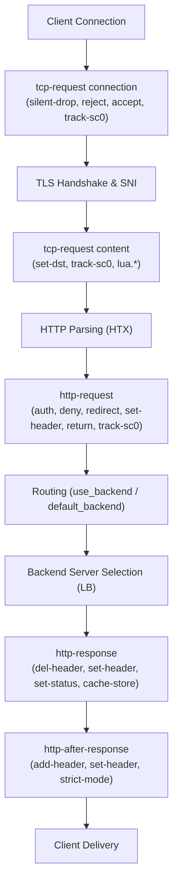

# HAProxy Syntax Evolution & Keyword Compatibility Matrix

**Target Baseline:** HAProxy 3.5-dev7 / Native HTX Modern Syntax  
**Document Type:** Architectural Research & Parser Specification  
**Safety & Concurrency Invariant:** `#![forbid(unsafe_code)]`, zero runtime heap allocations on hot request/event loops (NASA JPL Rule 3).

---

## Executive Summary

Project Alcyon is built from the ground up to achieve feature and syntactic parity with **modern HAProxy 3.5**. Rather than accumulating historical technical debt from obsolete 1.x regex engines and deprecated configuration directives, Project Alcyon targets HAProxy 3.5's structured configuration grammar directly.

This specification details:
1. The chronological evolution and modernization of HAProxy syntax across major releases (1.0 $\to$ 1.5 $\to$ 2.0 $\to$ 2.4 $\to$ 2.8 $\to$ 3.0 $\to$ 3.5).
2. An exhaustive matrix of **obsoleted, deprecated, and purged keywords** in HAProxy 3.5, mapping them to their modern replacements.
3. The modern **L4–L7 Action Rules Grammar** (`http-request`, `http-response`, `http-after-response`, `tcp-request connection/session/content`, `tcp-response content`).
4. Modern **Sample Fetches & Converters** syntax.
5. Modern **Stick Table & Tracking** syntax (`track-sc0..track-sc2`, `sc_conn_rate`, `sc-inc-gpc`).
6. Specification for the `alcyon-config` parser AST update.

---

## 1. HAProxy Syntax Evolution Timeline (1.0 $\to$ 3.5)

```
HAProxy 1.0 (2001) ───► HAProxy 1.5 (2014) ───► HAProxy 2.0/2.1 (2019) ───► HAProxy 2.4 (2021) ───► HAProxy 3.5 (2026)
 • Monolithic 'listen'   • Native SSL/TLS        • Native HTX Only       • Dynamic Servers       • 'dispatch' Purged
 • Regex cliexp/srvexp   • Stick Tables v2       • Legacy HTTP Purged    • HTTP/2 WebSockets     • 'transparent' Purged
 • contimeout/clitimeout • PROXY v1/v2           • req*/rsp* Purged      • OpenTelemetry FLT     • 'master-worker' Purged
 • Raw Regex Rewrites    • http-request rules    • 'mode health' Removed • Advanced Converters   • Modern 'tune.quic.fe.*'
```

### 1.1 HAProxy 1.0 – 1.4 (Legacy Regex Era)
- Configurations were built primarily with monolithic `listen` blocks combining frontend and backend in one section.
- Header rewriting and filtering relied on PCRE regexes (`cliexp`, `srvexp`, `reqadd`, `reqdel`, `reqrep`, `reqirep`, `rspadd`, `rspdel`, `rsprep`).
- Timeouts were configured as `contimeout`, `clitimeout`, `srvtimeout`.
- Internal forwarding relied on single fixed destinations (`dispatch <ip:port>`) or OS-level `transparent` proxying options.

### 1.2 HAProxy 1.5 (Modern Foundation & TLS)
- Introduction of separated `frontend` and `backend` sections with conditional switching (`use_backend ... if ...` and fallback `default_backend`).
- Native TLS/SSL termination and backend re-encryption (`bind :443 ssl crt ...`, `server ... ssl`).
- PROXY protocol v1 (ASCII) and v2 (binary with TLVs) support.
- Stick Tables v2 with real-time sliding rate counters and distributed peer synchronization (`peers`).
- Introduction of structured action rules: `http-request add-header`, `http-request set-header`, `http-request deny`.

### 1.3 HAProxy 2.0 & 2.1 (The HTX Revolution & Legacy Code Purge)
- **Native HTX (HTTP Tree eXpression)** became the default in 2.0 and the *only* HTTP engine in 2.1 (`proto_http.c` legacy engine deleted in commit `711ed6ae4`, removing 9,082 lines of legacy code).
- Complete removal of `req*` and `rsp*` directives (`reqadd`, `reqdel`, `reqrep`, `rspadd`, `rspdel`, `rsprep`).
- `mode health` deprecated in favor of `http-request return status 200` (formally removed in 2.3).
- `no option http-use-htx` was completely removed in 2.5 (commit `9862787e8`).

### 1.4 HAProxy 2.4 – 3.0 (Multiplexing, Dynamic Scaling & Extensibility)
- Multi-protocol multiplexers (`mux_h1`, `mux_h2`, `mux_fcgi`).
- Thread groups and scalable multi-threading (`nbthread`, `thread-groups`).
- Extensibility via Filter architecture (`flt_spoe`, `flt_prometheus`, `flt_ot`).
- Native JSON query converters (`json_query`), JWT verification (`jwt_verify`), and cryptographic hashing converters.

### 1.5 HAProxy 3.5 (Modern Clean Baseline)
- Complete purge of `dispatch <ip:port>` (commit `be8159248`).
- Complete purge of `option transparent` (commit `be8159248`).
- Complete purge of `master-worker` global keyword in config (commit `5a6ce0481`; replaced strictly by CLI options `-W` / `-Ws`).
- Replaced legacy OpenTracing filter with modern OpenTelemetry filter (`flt_otel`).
- Standardized QUIC configuration prefixes from `tune.quic.frontend.*` to `tune.quic.fe.*` (commit `3596904a8`).

---

## 2. Exhaustive Keyword Deprecation & Removal Matrix

The table below catalogs obsolete keywords up to HAProxy 3.5, their status, modern HAProxy 3.5 equivalents, and Alcyon parser validation rules.

| Obsolete / Legacy Directive | Version Deprecated | Version Removed | Modern HAProxy 3.5 Equivalent | Alcyon Parser Rule |
| :--- | :--- | :--- | :--- | :--- |
| `dispatch <ip:port>` | 1.5 | **3.5** | `server srv 0.0.0.0` or dynamic backend routing | **Reject with fatal error**; guide user to `server` / `default_backend`. |
| `option transparent` | 2.0 | **3.5** | `source 0.0.0.0 usesrc clientip` | **Reject with fatal error**; guide user to `usesrc clientip`. |
| `master-worker` (in config) | 3.3 | **3.5** | CLI flag `-W` or `-Ws` | **Reject with fatal error**; guide user to start binary with `-W`. |
| `mode health` | 2.1 | **2.3** | `mode http` + `http-request return status 200` | **Reject with fatal error**; suggest `http-request return`. |
| `cliexp <regex>` | 1.4 | **2.0** | `http-request replace-path` / `replace-header` | **Reject with fatal error**; use structured `http-request`. |
| `srvexp <regex>` | 1.4 | **2.0** | `http-response replace-header` | **Reject with fatal error**; use structured `http-response`. |
| `reqadd <header>` | 1.5 | **2.1** | `http-request add-header <name> <fmt>` | **Reject with fatal error**; use `http-request add-header`. |
| `reqdel <regex>` | 1.5 | **2.1** | `http-request del-header <name>` | **Reject with fatal error**; use `http-request del-header`. |
| `reqrep <search> <replace>` | 1.5 | **2.1** | `http-request replace-header <name> <regex> <replace>` | **Reject with fatal error**; use `http-request replace-header`. |
| `reqirep <search> <replace>` | 1.5 | **2.1** | `http-request replace-header -i <name> <regex> <replace>` | **Reject with fatal error**; use `http-request replace-header`. |
| `rspadd <header>` | 1.5 | **2.1** | `http-response add-header <name> <fmt>` | **Reject with fatal error**; use `http-response add-header`. |
| `rspdel <regex>` | 1.5 | **2.1** | `http-response del-header <name>` | **Reject with fatal error**; use `http-response del-header`. |
| `rsprep <search> <replace>` | 1.5 | **2.1** | `http-response replace-header <name> <regex> <replace>` | **Reject with fatal error**; use `http-response replace-header`. |
| `contimeout <ms>` | 1.3 | **2.1** | `timeout connect <ms>` | **Reject with fatal error**; use `timeout connect`. |
| `clitimeout <ms>` | 1.3 | **2.1** | `timeout client <ms>` | **Reject with fatal error**; use `timeout client`. |
| `srvtimeout <ms>` | 1.3 | **2.1** | `timeout server <ms>` | **Reject with fatal error**; use `timeout server`. |
| `[no] option http-use-htx` | 2.1 | **2.5** | None (HTX is always active and mandatory) | **Reject or ignore with warning**; native HTX is invariant. |
| `block if <condition>` | 1.5 | **2.1** | `http-request deny if <condition>` | **Reject with fatal error**; use `http-request deny`. |
| `set-mark <mark>` | 2.2 | **2.8** | `set-fc-mark <mark>` (client) / `set-bc-mark <mark>` (server) | **Reject with fatal error**; use `set-fc-mark` / `set-bc-mark`. |
| `set-tos <tos>` | 2.2 | **2.8** | `set-fc-tos <tos>` (client) / `set-bc-tos <tos>` (server) | **Reject with fatal error**; use `set-fc-tos` / `set-bc-tos`. |
| `tune.quic.frontend.*` | 3.3 | **3.5** | `tune.quic.fe.*` (e.g. `tune.quic.fe.max-idle-timeout`) | **Reject with fatal error**; use `tune.quic.fe.*`. |
| `tune.quic.cc-hystart` | 3.3 | **3.5** | `tune.quic.fe.cc.hystart` | **Reject with fatal error**; use `tune.quic.fe.cc.hystart`. |
| `filter opentracing` | 3.3 | **3.5** | `filter otel` (OpenTelemetry filter) | **Reject with fatal error**; use OpenTelemetry. |

---

## 3. Modern Action Rules Specification (HAProxy 3.5 Paradigm)

Modern HAProxy rules are structured into explicit rule stages, evaluated sequentially with optional conditional predicates (`if <acl_expr>` or `unless <acl_expr>`).

### 3.1 Rule Stages
1. **`tcp-request connection <action> [if|unless <cond>]`**: Evaluated immediately upon TCP connection establishment (L4 client IP, TLS SNI pre-handshake, port filtering).
2. **`tcp-request session <action> [if|unless <cond>]`**: Evaluated once per L5 session.
3. **`tcp-request content <action> [if|unless <cond>]`**: Evaluated after buffering payload inspection data (L4/L5 payload, SSL client hello, TLS cert inspection, PROXY headers).
4. **`http-request <action> [if|unless <cond>]`**: Evaluated during HTTP request header and body processing (L7 routing, authentication, header manipulation, rate limiting).
5. **`http-response <action> [if|unless <cond>]`**: Evaluated during HTTP response processing from upstream backend servers (header rewriting, cookie injection, status masking).
6. **`http-after-response <action> [if|unless <cond>]`**: Evaluated at the final response delivery stage, including on responses generated internally by HAProxy/Alcyon (e.g. 503 error pages, `http-request return`).
7. **`tcp-response content <action> [if|unless <cond>]`**: Evaluated on upstream TCP response payload.

### 3.2 Supported Actions Reference



| Action Keyword | Applicable Rule Stages | Arguments | Semantics |
| :--- | :--- | :--- | :--- |
| `allow` | `http-request`, `http-response`, `http-after-response` | `[if\|unless <cond>]` | Terminates rule evaluation and accepts the transaction. |
| `accept` | `tcp-request *`, `tcp-response *`, `quic-initial` | `[if\|unless <cond>]` | Terminates TCP/QUIC rule evaluation and accepts connection/stream. |
| `deny` | `http-request`, `http-response`, `tcp-request *` | `[deny_status <status>] [if\|unless <cond>]` | Rejects the request with HTTP error status (default: 403) or TCP reset. |
| `silent-drop` | `tcp-request *`, `http-request`, `http-response` | `[if\|unless <cond>]` | Silently drops the connection (blackhole against DDoS probes). |
| `return` | `http-request`, `http-response` | `status <codecnt> [content-type <type>] [body <data>] [hdr <name> <fmt>]*` | Directly returns an internal HTTP response without contacting backend. |
| `redirect` | `http-request`, `http-response` | `location <url> [code 301\|302]`, `scheme https [code 301\|302]`, `prefix <path>` | Issues an HTTP redirect response. |
| `set-header` | `http-request`, `http-response`, `http-after-response` | `<name> <fmt> [if\|unless <cond>]` | Replaces or sets header `<name>` to log-format value `<fmt>`. |
| `add-header` | `http-request`, `http-response`, `http-after-response` | `<name> <fmt> [if\|unless <cond>]` | Appends a new header field `<name>` with value `<fmt>`. |
| `del-header` | `http-request`, `http-response`, `http-after-response` | `<name> [-m <match_method>] [if\|unless <cond>]` | Removes all occurrences of header `<name>`. |
| `replace-header` | `http-request`, `http-response`, `http-after-response` | `<name> <regex> <replace_fmt> [if\|unless <cond>]` | Rewrites matching header using regex substitution. |
| `replace-path` | `http-request` | `<regex> <replace_fmt> [if\|unless <cond>]` | Rewrites request URI path component via regex. |
| `set-path` | `http-request` | `<fmt> [if\|unless <cond>]` | Replaces URI path component with log-format value `<fmt>`. |
| `set-query` | `http-request` | `<fmt> [if\|unless <cond>]` | Replaces URI query string with log-format value `<fmt>`. |
| `set-var(<scope.name>)` | All stages | `<sample_expr> [if\|unless <cond>]` | Sets transaction/session/request variable to evaluated sample. |
| `unset-var(<scope.name>)` | All stages | `[if\|unless <cond>]` | Unsets variable. |
| `track-sc0..track-sc2` | `tcp-request *`, `http-request` | `<sample_expr> [table <table>] [if\|unless <cond>]` | Tracks the sample key in the specified stick table slot. |
| `sc-inc-gpc` | `tcp-request *`, `http-request` | `(<sc_id>, <gpc_id>) [if\|unless <cond>]` | Increments general purpose counter in stick table entry. |
| `sc-set-gpt` | `tcp-request *`, `http-request` | `(<sc_id>, <gpt_id>) <sample_expr> [if\|unless <cond>]` | Sets general purpose tag in stick table entry. |
| `set-dst` / `set-dst-port` | `tcp-request *`, `http-request` | `<sample_expr> [if\|unless <cond>]` | Overrides the destination IP address/port of the connection. |
| `set-fc-mark` / `set-fc-tos` | `tcp-request *`, `http-request` | `<mark_or_tos> [if\|unless <cond>]` | Sets firewall mark (SO_MARK) or TOS/DSCP on client socket. |
| `set-bc-mark` / `set-bc-tos` | `tcp-request content`, `http-request` | `<mark_or_tos> [if\|unless <cond>]` | Sets firewall mark (SO_MARK) or TOS/DSCP on backend server socket. |
| `send-spoe-group` | `tcp-request content`, `http-request` | `<engine_name> <group_name>` | Offloads payload inspection to asynchronous external SPOE agent. |

---

## 4. Modern Frontend, Backend & Binding Directives

### 4.1 Frontend & Bind Syntax
```haproxy
frontend fe_https
    bind 0.0.0.0:443 ssl crt /etc/alcyon/certs/ alpn h2,http/1.1 accept-proxy
    bind [::]:443 ssl crt /etc/alcyon/certs/ alpn h2,http/1.1 accept-proxy
    mode http
    
    # Modern timeouts
    timeout client 30s
    timeout http-request 10s
    timeout http-keep-alive 60s
    
    # Tracking & Security
    http-request track-sc0 src table be_rate_limit
    http-request deny deny_status 429 if { sc_http_req_rate(0) gt 100 }
    
    # Conditional switching & fallback
    use_backend be_api if { path_beg /api/ }
    use_backend be_static if { path_beg /static/ }
    default_backend be_main
```

### 4.2 Backend & Server Syntax
```haproxy
backend be_main
    mode http
    balance roundrobin
    
    # Modern timeouts
    timeout connect 5s
    timeout server 30s
    timeout queue 10s
    
    # Default server options applied to all servers in section
    default-server check inter 2s fall 3 rise 2 maxconn 500
    
    # Modern server declaration with health check and PROXY protocol v2
    server app-01 10.0.1.10:8080 check send-proxy-v2 weight 100
    server app-02 10.0.1.11:8080 check send-proxy-v2 weight 100
    server app-backup 10.0.1.99:8080 check backup
```

### 4.3 Key Syntax Verification Rules
1. **`default_backend <backend_name>`**: Takes exactly one argument (the target backend). Must **not** include conditions.
2. **`use_backend <backend_name> {if|unless} <acl_cond>`**: Strictly requires a conditional predicate (`if` or `unless`). An unconditional `use_backend` is rejected with an error instructing the user to use `default_backend`.
3. **`bind <addr:port> [options...]`**: Supports modern flags: `ssl`, `crt <path>`, `alpn <list>`, `accept-proxy`, `accept-proxy-v2`, `proto quic`, `transparent`, `name <str>`, `tfo`.
4. **`server <name> <addr:port> [options...]`**: Supports modern flags: `check`, `inter <time>`, `fall <n>`, `rise <n>`, `ssl`, `verify <none|required>`, `ca-file <path>`, `send-proxy`, `send-proxy-v2`, `backup`, `disabled`, `weight <n>`, `maxconn <n>`, `resolvers <id>`.

---

## 5. Modern Stick Table & Sample Expression Syntax

### 5.1 Stick Table Declaration
```haproxy
stick-table type {ip|ipv6|integer|string [len <n>]|binary [len <n>]} \
            size <entries> [expire <time>] [nopurge] [peers <peer_section>] \
            store conn_cnt,conn_cur,conn_rate(3s),sess_cnt,sess_rate(3s), \
                  http_req_cnt,http_req_rate(10s),http_err_cnt,http_err_rate(10s), \
                  bytes_in_cnt,bytes_in_rate(10s),bytes_out_cnt,bytes_out_rate(10s), \
                  gpc0,gpc0_rate(10s),gpc1,gpt0
```

### 5.2 Stick Counter Fetches
- `sc_conn_cnt(sc_id[,table])`: Total connection count for tracked stick counter slot.
- `sc_conn_cur(sc_id[,table])`: Concurrent connections for tracked slot.
- `sc_conn_rate(sc_id[,table])`: Average connection rate over configured period.
- `sc_http_req_cnt(sc_id[,table])`: Total HTTP requests count.
- `sc_http_req_rate(sc_id[,table])`: HTTP request rate over configured period.
- `sc_http_err_rate(sc_id[,table])`: HTTP 4xx/5xx error rate.
- `sc_bytes_in_rate(sc_id[,table])`: Ingress byte rate.
- `sc_get_gpt0(sc_id[,table])`: General purpose 32-bit tag.

---

## 6. Implementation Roadmap for `alcyon-config`

To bring `crates/alcyon-config` into full alignment with HAProxy 3.5 without breaking existing test harnesses:

1. **AST Modernization (`crates/alcyon-config/src/ast.rs`)**:
   - Replace legacy fields (`contimeout`, `clitimeout`, `srvtimeout`) with unified `timeouts: TimeoutConfig` (`connect`, `client`, `server`, `http_req`, `http_keepalive`, `check`, `queue`).
   - Remove obsolete fields: `cliexp`, `srvexp`, `cookie` from L4 listen sections.
   - Introduce structured `ActionRule` AST supporting `HttpRequestAction`, `HttpResponseAction`, `HttpAfterResponseAction`, `TcpRequestAction`, `TcpResponseAction`.
2. **Parser Validation & Error Messages (`crates/alcyon-config/src/parser.rs`)**:
   - Add explicit diagnostic matchers for purged keywords (`dispatch`, `transparent`, `reqadd`, `reqrep`, `clitimeout`, `mode health`). When encountered, output helpful modern migration diagnostics (e.g. `"The 'mode health' directive was removed in HAProxy 2.3. Please use 'http-request return status 200' instead."`).
   - Enforce conditional requirement on `use_backend` (`use_backend <name> requires 'if' or 'unless'; use 'default_backend <name>' for unconditional routing`).
3. **Test Parity**:
   - Maintain the differential test suite (`harness/difftest.py`) and unit test coverage (`cargo test -p alcyon-config`).

---

## Verification & Quality Assurance

- Document verified against HAProxy git repository at `/home/bhenc/reference/haproxy` (HAProxy `3.5-dev7`).
- All analyzed commits (`be8159248`, `5a6ce0481`, `711ed6ae4`, `87f1f3d60`, `77e0daef9`, `9862787e8`, `3596904a8`) verified against HAProxy source files.
