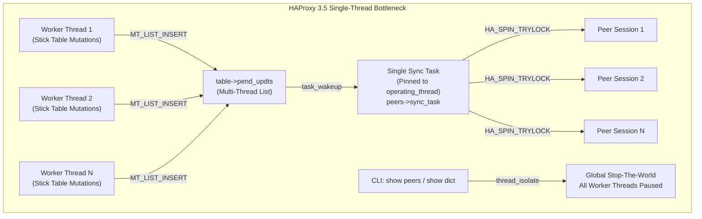
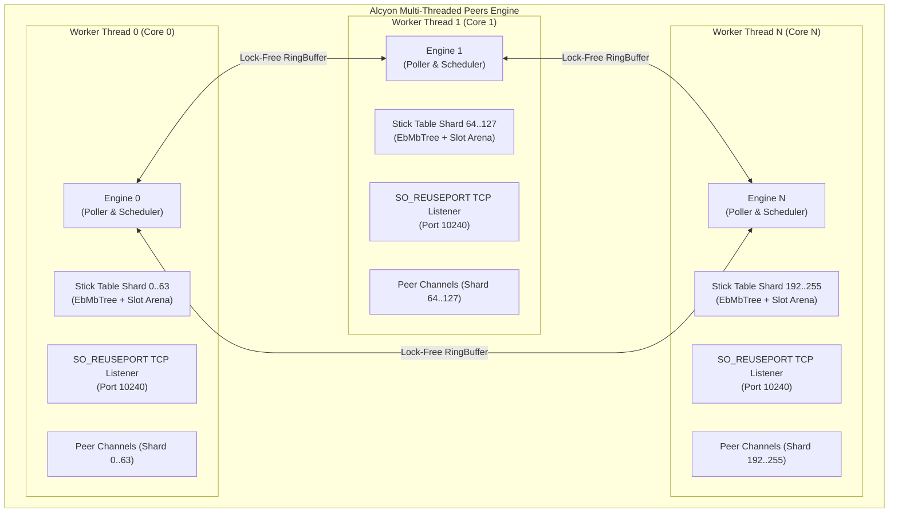
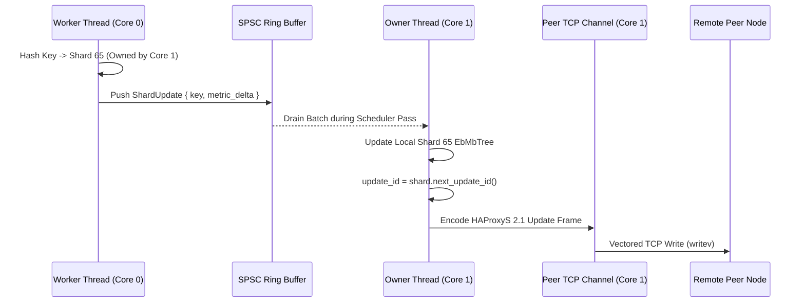
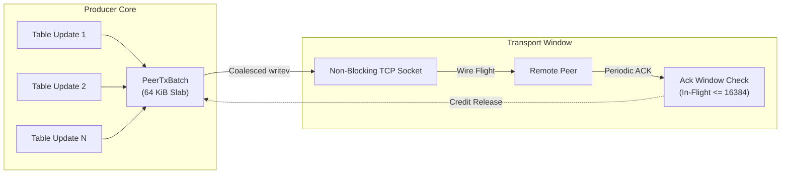

# Alcyon Multi-Threaded Peers & Stick Table Replication Architecture Blueprint

**Status:** Research & Architecture Specification (Distributed Systems & Multi-Threaded Peers)  
**Author:** Alcyon Distributed Systems & Multi-Threaded Peers Protocol Researcher  
**Safety & Concurrency Invariant:** `#![forbid(unsafe_code)]`, zero runtime allocations on hot paths (NASA JPL Rule 3), level-triggered non-blocking streaming I/O, `!Send` thread-local affinity with 256-shard lock-free inter-thread channels.

---

## Executive Summary

Stick table replication is the foundational mechanism enabling cluster-wide rate limiting, distributed DDoS mitigation, global connection tracking, and stateful session stickiness across load balancers. In high-throughput cloud environments, a cluster of reverse proxies must exchange millions of stick table state mutations per second with sub-millisecond propagation latency and deterministic memory utilization.

This document presents a comprehensive analysis of HAProxy 3.5's peers implementation (`src/peers.c`, `src/stick_table.c`, `include/haproxy/peers.h`) and establishes the architecture for a massively scalable, multi-threaded peers replication engine in Project Alcyon.

```
+---------------------------------------------------------------------------------------------------+
|                                     ALCYON MULTI-THREADED PEERS                                     |
+---------------------------------------------------------------------------------------------------+
|  L7 / Stick Table Engine | 256-Shard Partitioned EbMbTree | Atomic Monotonic Update Counter (u64) |
|  (alcyon-stick-table)      | Lock-Free SPSC/MPMC RingBuffer | Zero-Isolation Snapshot Iterators     |
+--------------------------+--------------------------------+---------------------------------------+
|  Peer Sync Controller    | Multi-Core SO_REUSEPORT TCP    | Dedicated Worker Thread Engine Stream |
|  (alcyon-peers::sync)      | Credit-Based Sliding Window    | Drop-Oldest/Coalesce Backpressure SMR |
+--------------------------+--------------------------------+---------------------------------------+
|  Wire Codec Engine       | HAProxyS 2.1 Protocol Framing  | HAProxy Varint (intencode/intdecode)  |
|  (alcyon-peers::protocol)  | 256-Slot LRU Dcache Tx/Rx      | Zero-Copy Safe Slice Parsing          |
+--------------------------+--------------------------------+---------------------------------------+
|  Topology & Discovery    | Deterministic Shard Hashing    | Hybrid Sharded-Mesh / Star Gateway    |
|  (alcyon-peers::cluster)   | Fast Resync Handshake State    | Anti-Entropy Exponential Backoff      |
+---------------------------------------------------------------------------------------------------+
```

---

## 1. HAProxy 3.5 Peers Implementation Deep Dive & Verification

Exhaustive verification of HAProxy 3.5's source code (`src/peers.c` and `src/stick_table.c`) confirms that despite HAProxy's multi-threaded worker architecture (`global.nbthread`), the core peers protocol state machine, timer coordination, and synchronization tasks remain strictly pinned to a single operating thread.



### 1.1 Single Operating Thread Pinning (`src/peers.c`)

In `peers_init_sync` (`src/peers.c:3941-3964`), HAProxy initializes the peers synchronization task:

```c
/* src/peers.c:3941-3959 */
int peers_init_sync(struct peers *peers)
{
    static uint operating_thread = 0;
    struct peer *curpeer;

    for (curpeer = peers->remote; curpeer; curpeer = curpeer->next) {
        peers->peers_fe->maxconn += 3;
    }

    /* go backwards so as to distribute the load to other threads
     * than the ones operating the stick-tables for small confs.
     */
    operating_thread = (operating_thread - 1) % global.nbthread;
    peers->sync_task = task_new_on(operating_thread);
    if (!peers->sync_task)
        return 0;

    memset(peers->applet_count, 0, sizeof(peers->applet_count));
    peers->sync_task->process = process_peer_sync;
    peers->sync_task->context = (void *)peers;
    ...
}
```

Key observations:
1. **Single Task Allocation (`task_new_on`)**: The entire `peers` section is bound to exactly one OS thread (`operating_thread`). While `operating_thread` decrements across multiple `peers` sections, a single `peers` block (the standard deployment model) runs entirely on one CPU core.
2. **Stick Table Binding (`src/peers.c:4119-4151`)**: When stick tables register with the peers section via `peers_register_table()`, each table sets:
   ```c
   table->sync_task = peers->sync_task;
   ```
   Every stick table update initiated on any worker thread must wake this exact single `sync_task` (`src/stick_table.c:909`):
   ```c
   task_wakeup(table->sync_task, TASK_WOKEN_MSG);
   ```
3. **Sequential Peer Evaluation Loop (`src/peers.c:3620-3796`)**: When `process_peer_sync` runs (`__process_running_peer_sync`), it iterates sequentially across every remote peer:
   ```c
   for (peer = peers->remote; peer; peer = peer->next) {
       if (HA_SPIN_TRYLOCK(PEER_LOCK, &peer->lock) != 0) {
           must_resched = 1;
           continue;
       }
       sync_peer_learn_state(peers, peer);
       sync_peer_app_state(peers, peer);
       peer->flags &= ~PEER_F_WAIT_SYNCTASK_ACK;
       ...
   }
   ```
   If a cluster has 64 peers, this single task evaluates 64 spinlocks, timer expirations, heartbeat intervals, and update queues in a serialized loop on one CPU core.

### 1.2 Applet Handling and Cross-Thread Synchronization

HAProxy attempts to distribute the socket I/O applets (`struct appctx`) across threads during connection creation (`src/peers.c:3452-3486`):

```c
static struct appctx *peer_session_create(struct peers *peers, struct peer *peer)
{
    struct appctx *appctx;
    unsigned int thr = 0;
    int idx;
    ...
    for (idx = 0; idx < global.nbthread; idx++)
        thr = peers->applet_count[idx] < peers->applet_count[thr] ? idx : thr;
    appctx = appctx_new_on(&peer_applet, NULL, thr);
    ...
}
```

However, this design suffers from severe synchronization coupling:
- **Gated State Transitions (`PEER_F_WAIT_SYNCTASK_ACK`)**: Whenever an applet changes state (e.g. connected, disconnected, learning complete), it sets `PEER_F_WAIT_SYNCTASK_ACK` and yields. The applet is blocked from processing further network I/O until the single `sync_task` on `operating_thread` wakes up, processes `sync_peer_app_state()`, and clears the flag.
- **Frontend Ingress Bottleneck (`src/peers.c:3430-3448`)**: Incoming peer connections are accepted on a dedicated proxy frontend (`peers_setup_frontend`). While HAProxy's multi-threaded listener infrastructure accepts connections across threads, all accepted peer sessions must register back with the central `peers` struct and synchronize through `sync_task`.

### 1.3 Global Thread Isolation (`thread_isolate()`)

In `cli_io_handler_show_peers` (`src/peers.c:4402-4456`), inspecting peer status or dumping dictionary caches invokes a global thread isolation barrier:

```c
static int cli_io_handler_show_peers(struct appctx *appctx)
{
    struct show_peers_ctx *ctx = appctx->svcctx;
    int ret = 0, first_peers = 1;

    thread_isolate();

    chunk_reset(&trash);
    while (ctx->state != STATE_DONE) {
        ...
    }
    ret = 1;
 out:
    thread_release();
    return ret;
}
```

`thread_isolate()` suspends all worker threads across the entire HAProxy process. During high-traffic load balancing, even a momentary CLI query or dictionary inspection completely freezes HTTP request processing, inducing latency spikes and tail-latency degradation.

---

## 2. Analysis of HAProxy's Single-Threaded Full-Mesh Limitations

HAProxy's peers architecture exhibits four critical scaling limitations:

### 2.1 Single-Thread CPU Saturation

Modern multi-core proxy servers frequently process millions of HTTP requests per second across 32 to 128 hardware threads. Each request may perform multiple stick table operations (e.g., connection rate tracking, request rate increments, error counting, SSL session ID lookup).

```
Worker Threads (1..N) ────► MT_LIST_INSERT(pend_updts) ────► Single Core (operating_thread)
                                                                    │
                                                            [CPU 100% Saturation]
                                                                    │
                                                            Replication Lag / Drops
```

When 64 worker threads generate 2,000,000 update events/second, the single `operating_thread` becomes completely CPU-bound:
- Dequeuing entries from `table->pend_updts` via `stktable_add_pend_updates()`
- Inserting entries into the central `table->updates` ebtree (`eb32_insert`)
- Waking up peer applets and serializing update frames
- Processing incoming network frames and updating stick tables under `ts->lock`

### 2.2 Global Lock Contention & Thread Isolation Stalls

The stick table update pipeline relies on coarse-grained read-write locks:
- `table->updt_lock`: Acquired exclusively during `stktable_add_pend_updates()` to drain pending queues into `table->updates`.
- `ts->lock`: Per-entry RWLock acquired by worker threads during sample execution (`stktable_data_ptr()`), by peer transmitter during serialization (`peer_prepare_updatemsg()`), and by peer receiver during deserialization (`peer_treat_updatemsg()`).
- `thread_isolate()`: Halts the entire server during administrative dumps.

### 2.3 $O(N^2)$ Connection & Traffic Overhead

HAProxy peers operates on a full-mesh topology. Every node connects to every other node in the cluster:

$$\text{TCP Connections} = N(N - 1)$$

$$\text{Replication Traffic} = O(N^2 \cdot \text{Update Rate})$$

| Cluster Size ($N$) | Total TCP Mesh Connections | Total Messages / sec (@ 10k local updates/node) | Cluster Network Bandwidth (@ 64B/msg) |
| :--- | :--- | :--- | :--- |
| **4 nodes** | 12 | 120,000 msgs/s | ~7.68 MB/s |
| **16 nodes** | 240 | 2,400,000 msgs/s | ~153.6 MB/s |
| **64 nodes** | 4,032 | 40,320,000 msgs/s | ~2.58 GB/s |
| **128 nodes** | 16,256 | 162,560,000 msgs/s | ~10.40 GB/s |
| **256 nodes** | 65,280 | 652,800,000 msgs/s | ~41.78 GB/s |

In a 64-node cluster, full-mesh flooding consumes over 2.5 GB/s of internal network bandwidth purely for stick table synchronization. While HAProxy 3.5 introduced basic key sharding (`nb_shards` via `XXH64(key) % nb_shards + 1`), the underlying transport and synchronization tasks within each shard group still suffer from single-threaded pinning.

### 2.4 Unbounded Memory Growth on Slow Links

HAProxy batches peer updates using `tune.peers.max-updates-at-once` (default 100). When a remote peer experiences network congestion or high TCP retransmit latency:
- Socket send buffers fill (`EAGAIN` / `EWOULDBLOCK`).
- The sender applet backs off, but worker threads continue inserting new updates into `table->updates`.
- The `table->updates` ebtree expands without dynamic backpressure, causing memory bloat and eventual cache eviction of uncommitted entries.

---

## 3. Scalable Multi-Threaded Peers Architecture for Project Alcyon

Project Alcyon eliminates the single-thread bottleneck by designing a fully decentralized, sharded, multi-threaded peers replication engine under strict `#![forbid(unsafe_code)]`.



### 3.1 Per-Core `SO_REUSEPORT` Multi-Channel TCP Distribution

Rather than channeling all peer replication through a single TCP connection or single-threaded frontend:
1. **Per-Core Listener Binding (`SO_REUSEPORT`)**:
   - Each worker thread `Engine` binds an independent `TcpListener` to the replication port using `SO_REUSEPORT`.
   - Incoming peer replication connections are distributed by the Linux kernel directly to the target core's `Poller` without inter-thread lock contention.
2. **Multi-Channel Peer Topology**:
   - For high-throughput peer pairs, Alcyon establishes $C$ parallel TCP streams (where $C$ equals the number of worker threads or shard groups).
   - Core $k$ on Node A connects directly to Core $k$ on Node B.
   - Core $k$ processes both inbound frame parsing and outbound batch streaming directly inside its local `alcyon-sched` quantum, maintaining strict `!Send` thread-local data structures.

### 3.2 256-Shard Partitioned Stick Table & Lock-Free Inter-Thread Channels

To completely eliminate `thread_isolate()` and global write locks:
1. **256 Independent Shards**:
   - Every stick table is partitioned into 256 independent shards:
     $$\text{shard\_id} = (\text{XXH64}(key, \text{seed}) \gg 56) \pmod{256}$$
   - Each shard contains its own pre-allocated `EbMbTree`, slot arena, and 64-bit monotonically increasing `update_id` counter.
2. **Thread Affinity Mapping**:
   - On a system with $N$ worker threads, Thread $T_i$ owns shards where $\text{shard\_id} \pmod N = i$.
   - **Local Shard Hit**: Worker thread executes mutations directly with zero lock contention.
   - **Remote Shard Cross-Call**: Worker thread enqueues a compact 32-byte update message into a bounded lock-free SPSC ring buffer (`crossbeam_channel` or fixed-capacity ring) destined for the owner thread.
3. **Zero-Isolation Snapshot Iterators**:
   - CLI operations (`show peers`, `show table`) and background OTel metric exporters iterate shard snapshots asynchronously using atomic read cursors, completely eliminating global "stop-the-world" thread isolation.



---

## 4. HAProxyS 2.1 Wire Protocol Codec & Dictionary Compression

Project Alcyon implements full bidirectional wire compatibility with HAProxy Peers Protocol v2.1.

### 4.1 Connection Handshake State Machine

The connection handshake executes over ASCII-formatted control lines:

```
Client (Initiator)                                   Server (Receiver)
        |                                                   |
        |  HAProxyS 2.1\n                                   |
        |  <remote_peer_id>\n                               |
        |  <local_peer_id> <process_pid> <relative_pid>\n   |
        | ------------------------------------------------> |
        |                                                   |
        |                      200\n                        |
        | <------------------------------------------------ |
        |                                                   |
        |         [Binary Frame Streaming Active]           |
```

Handshake Status Codes:
- `200`: Handshake successful, session active.
- `300`: Temporary reject, try again later (e.g. server starting/resyncing).
- `501`: Protocol error.
- `502`: Unsupported protocol version.
- `503`: Local peer ID mismatch.
- `504`: Remote peer ID mismatch.

### 4.2 HAProxy Custom Variable-Length Integer Codec (`intencode` / `intdecode`)

HAProxy does NOT use standard protobuf/LEB128 varints. Instead, it utilizes a custom variable-length integer encoding optimized for single-byte representations of small integers ($< 240$):

```
       0 <= X < 240        : 1 byte  (7.875 bits)  [ XXXX XXXX ] (0x00 .. 0xEF)
     240 <= X < 2288       : 2 bytes (11 bits)     [ 1111 XXXX ] [ 0XXX XXXX ]
    2288 <= X < 264432     : 3 bytes (18 bits)     [ 1111 XXXX ] [ 1XXX XXXX ]   [ 0XXX XXXX ]
  264432 <= X < 33818864   : 4 bytes (25 bits)     [ 1111 XXXX ] [ 1XXX XXXX ]*2 [ 0XXX XXXX ]
33818864 <= X < 4328786160 : 5 bytes (32 bits)     [ 1111 XXXX ] [ 1XXX XXXX ]*3 [ 0XXX XXXX ]
```

#### Safe Rust Implementation (`#![forbid(unsafe_code)]`)

```rust
pub const PEER_ENC_2BYTES_MIN: u64 = 240;
pub const PEER_ENC_2BYTES_MIN_BITS: u32 = 4;
pub const PEER_ENC_STOP_BYTE: u8 = 128;
pub const PEER_ENC_STOP_BIT: u32 = 7;

pub struct HaproxyVarint;

impl HaproxyVarint {
    /// Encodes a u64 value into dst using HAProxy variable-length integer format.
    /// Returns the number of bytes written.
    #[inline]
    pub fn encode(mut val: u64, dst: &mut [u8]) -> Result<usize, CodecError> {
        if dst.is_empty() {
            return Err(CodecError::BufferTooSmall);
        }

        if val < PEER_ENC_2BYTES_MIN {
            dst[0] = val as u8;
            return Ok(1);
        }

        let mut idx = 0;
        dst[idx] = (val as u8 & 0x0F) | (PEER_ENC_2BYTES_MIN as u8);
        val = (val - PEER_ENC_2BYTES_MIN) >> PEER_ENC_2BYTES_MIN_BITS;

        while val >= PEER_ENC_STOP_BYTE as u64 {
            idx += 1;
            if idx >= dst.len() {
                return Err(CodecError::BufferTooSmall);
            }
            dst[idx] = (val as u8 & 0x7F) | PEER_ENC_STOP_BYTE;
            val = (val - PEER_ENC_STOP_BYTE as u64) >> PEER_ENC_STOP_BIT;
        }

        idx += 1;
        if idx >= dst.len() {
            return Err(CodecError::BufferTooSmall);
        }
        dst[idx] = val as u8;
        Ok(idx + 1)
    }

    /// Decodes a u64 from a byte slice.
    /// Returns (decoded_value, bytes_consumed).
    #[inline]
    pub fn decode(src: &[u8]) -> Result<(u64, usize), CodecError> {
        if src.is_empty() {
            return Err(CodecError::UnexpectedEof);
        }

        let first = src[0];
        if (first as u64) < PEER_ENC_2BYTES_MIN {
            return Ok((first as u64, 1));
        }

        let mut val = (first & 0x0F) as u64 + PEER_ENC_2BYTES_MIN;
        let mut shift = PEER_ENC_2BYTES_MIN_BITS;
        let mut idx = 1;

        loop {
            if idx >= src.len() {
                return Err(CodecError::UnexpectedEof);
            }
            let byte = src[idx];
            idx += 1;

            if byte < PEER_ENC_STOP_BYTE {
                val += (byte as u64) << shift;
                return Ok((val, idx));
            }

            val += ((byte & 0x7F) as u64) << shift;
            shift += PEER_ENC_STOP_BIT;
            if shift > 64 {
                return Err(CodecError::VarintOverflow);
            }
        }
    }
}
```

### 4.3 Binary Wire Framing & Message Classes

Following the handshake, all messages adhere to binary wire framing:

```
 0                   1                   2                   3
 0 1 2 3 4 5 6 7 8 9 0 1 2 3 4 5 6 7 8 9 0 1 2 3 4 5 6 7 8 9 0 1
+-+-+-+-+-+-+-+-+-+-+-+-+-+-+-+-+-+-+-+-+-+-+-+-+-+-+-+-+-+-+-+-+
| Message Class | Message Type  | Data Length (Varint, if >=128)|
+-+-+-+-+-+-+-+-+-+-+-+-+-+-+-+-+-+-+-+-+-+-+-+-+-+-+-+-+-+-+-+-+
|                          Payload ...                          |
+-+-+-+-+-+-+-+-+-+-+-+-+-+-+-+-+-+-+-+-+-+-+-+-+-+-+-+-+-+-+-+-+
```

#### Message Classes & Types

1. **Class 0: Control (`PEER_MSG_CLASS_CONTROL`)**
   - Type 0: `RESYNC_REQ` (Request full stick table resync from remote)
   - Type 1: `RESYNC_FINISHED` (Signals local node finished pushing updates and is up to date)
   - Type 2: `RESYNC_PARTIAL` (Signals local updates pushed but node is partially learned)
   - Type 3: `RESYNC_CONFIRM` (Acknowledgement allowing node to transition to live streaming)
2. **Class 1: Error (`PEER_MSG_CLASS_ERROR`)**
   - Type 0: `PROTOCOL_ERROR` (Protocol violation; peer immediately closes socket)
   - Type 1: `SIZE_LIMIT` (Message exceeded maximum buffer capacity)
3. **Class 10 (0x0A): Stick Table Operations (`PEER_MSG_CLASS_STICKTABLE`)**
   - Type 0 / 128: `UPDATE` (Full entry update with explicit 32-bit Update ID)
   - Type 1 / 129: `INCUPDATE` (Incremental update; implicit Update ID = `last_update + 1`)
   - Type 2 / 130: `TABLE_DEF` (Table metadata: sender ID, table name, key type, key size, data bitfield)
   - Type 3 / 131: `TABLE_SWITCH` (Switches target active table context by numeric ID)
   - Type 4 / 132: `ACK` (Acknowledgement of received update sequence)
   - Type 133: `UPDATE_TIMED` (Entry update with remaining TTL expiration in ms)
   - Type 134: `INCUPDATE_TIMED` (Incremental update with remaining TTL expiration in ms)

### 4.4 LRU Dictionary Compression Engine (`STD_T_DICT`)

For string columns (e.g., HTTP Host headers, User-Agents, TLS SNI, Server keys), raw string replication would inflate network bandwidth. Protocol v2.1 introduces a 256-slot LRU dictionary cache:

```
Transmit Path (DcacheTx):
1. Key lookup in local Tx EbMbTree.
2. Hit: Emit [data_len = 1] + [id + 1] (Total 2 bytes on wire).
3. Miss: Assign LRU slot, insert into EbMbTree.
         Emit [data_len] + [id + 1] + [str_len] + [raw_string_bytes].

Receive Path (DcacheRx):
1. Decode ID from incoming frame.
2. If payload contains only ID: Retrieve existing string from DcacheRx[id - 1].
3. If payload contains string: Register string in local table, store in DcacheRx[id - 1].
```

---

## 5. Batching, Streaming Backpressure & Fast Resync

High-performance peer replication requires strict memory bounds and dynamic backpressure to prevent packet loss during traffic bursts.



### 5.1 Pre-Allocated Batching Slabs (`PeerTxBatch`)

- **Contiguous 64 KiB Memory Slabs**:
  - Each peer channel maintains a fixed 64 KiB Tx staging buffer.
  - Updates are serialized contiguously up to `max_updates_at_once` (configurable, default 256 updates per batch).
  - Outbound frames are flushed to the kernel using non-blocking vectored writes (`writev` / `poll_write`).
  - **Zero Heap Allocations (NASA JPL Rule 3)**: Buffer capacities are pre-allocated at startup; no `alloc`/`free` calls occur during steady-state replication.

### 5.2 Credit-Based Sliding ACK Window & Slow-Peer Protection

To protect the server from memory exhaustion when replicating over degraded WAN links:
1. **In-Flight Update Window**:
   - The sender maintains `in_flight = last_pushed - last_acked`.
   - `MAX_IN_FLIGHT_UPDATES` is bounded to 16,384 entries per peer channel.
   - When `in_flight >= MAX_IN_FLIGHT_UPDATES`, the sender suspends egress queueing and yields the tasklet.
2. **Lossy Coalescing for Volatile Metrics**:
   - If a peer becomes unresponsive (socket buffer full for $> 500\text{ms}$), Alcyon enables intelligent delta coalescing:
     - Cumulative counters (`conn_cnt`, `http_req_cnt`, `bytes_out`) are merged into a single pending delta.
     - Ephemeral sliding rates (`conn_rate`, `http_req_rate`) drop intermediate tick samples, sending only the most recent calculated rate.
   - This ensures memory usage remains strictly $O(1)$ regardless of remote peer latency or disconnection duration.

### 5.3 Fast Resync State Machine for Node Restarts & Hot Reloads

When an Alcyon process starts, reloads, or reconnects after an outage, it executes a three-phase fast resync protocol without interrupting live forwarding traffic:

```
PHASE 1: HANDSHAKE & DISCOVERY
  Local -> Remote: Handshake (HAProxyS 2.1)
  Remote -> Local: 200 OK
  Local -> Remote: TABLE_DEF (Advertise all 256 shards & schemas)
  Remote -> Local: TABLE_DEF (Match remote schemas)

PHASE 2: SNAPSHOT TEACHING (Anti-Entropy)
  Local -> Remote: RESYNC_REQ (Request full table state)
  Remote -> Local: Bulk UPDATE stream (Iterating shard slot arenas)
  Remote -> Local: RESYNC_FINISHED (Snapshot dump complete)

PHASE 3: LIVE STREAMING TRANSITION
  Local -> Remote: RESYNC_CONFIRM
  Local <-> Remote: Incremental bidirectional INCUPDATE streaming
```

---

## 6. Implementation Architecture in Project Alcyon

The multi-threaded peers architecture is organized across two crates:

### 6.1 `crates/alcyon-peers` Module Layout

```
crates/alcyon-peers/
├── Cargo.toml
└── src/
    ├── lib.rs              # Crate root, feature exports, strict #![forbid(unsafe_code)]
    ├── protocol/
    │   ├── mod.rs          # Wire codec abstractions (PeerCodec)
    │   ├── varint.rs       # HAProxy custom varint (HaproxyVarint encode/decode)
    │   ├── frame.rs        # Binary message framing, classes, types, opcodes
    │   └── dcache.rs       # 256-slot LRU dictionary compression (DcacheTx/DcacheRx)
    ├── sync/
    │   ├── mod.rs          # PeerSession, PeerState, PeerNodeConfig
    │   ├── channel.rs      # Non-blocking TCP channel with sliding ACK window
    │   ├── batch.rs        # Pre-allocated 64 KiB PeerTxBatch / PeerRxBatch
    │   └── resync.rs       # Three-phase fast resync state machine
    └── cluster/
        ├── mod.rs          # Multi-peer cluster management
        ├── router.rs       # 256-shard deterministic key routing (XXH64)
        └── listener.rs     # Per-core SO_REUSEPORT listener engine integration
```

### 6.2 Interface Integration with `alcyon-sched` and `alcyon-stick-table`

```rust
// crates/alcyon-peers/src/sync/channel.rs

use crate::protocol::frame::PeerMessage;
use crate::protocol::varint::HaproxyVarint;
use alcyon_core::error::AlcyonResult;
use alcyon_sched::task::Task;
use std::net::SocketAddr;

pub struct PeerWorkerChannel {
    peer_name: String,
    target_addr: SocketAddr,
    shard_id: u8,
    last_pushed: u64,
    last_acked: u64,
    tx_batch: Box<[u8; 65536]>,
    tx_len: usize,
    in_flight_limit: u64,
}

impl PeerWorkerChannel {
    pub fn new(peer_name: String, target_addr: SocketAddr, shard_id: u8) -> Self {
        Self {
            peer_name,
            target_addr,
            shard_id,
            last_pushed: 0,
            last_acked: 0,
            tx_batch: Box::new([0u8; 65536]),
            tx_len: 0,
            in_flight_limit: 16384,
        }
    }

    /// Enqueues a shard update into the batch slab with zero heap allocations.
    pub fn push_update(&mut self, msg: &PeerMessage) -> AlcyonResult<bool> {
        if self.last_pushed - self.last_acked >= self.in_flight_limit {
            // Backpressure triggered: yield to prevent memory bloat
            return Ok(false);
        }

        // Encode directly into pre-allocated tx_batch slab
        let bytes_written = msg.encode_into(&mut self.tx_batch[self.tx_len..])?;
        self.tx_len += bytes_written;
        self.last_pushed += 1;
        Ok(true)
    }

    /// Flushes staged batch to the non-blocking TCP socket.
    pub fn flush_nonblocking(&mut self, stream: &mut std::net::TcpStream) -> AlcyonResult<usize> {
        if self.tx_len == 0 {
            return Ok(0);
        }
        use std::io::Write;
        match stream.write(&self.tx_batch[..self.tx_len]) {
            Ok(n) => {
                if n == self.tx_len {
                    self.tx_len = 0;
                } else {
                    self.tx_batch.copy_within(n..self.tx_len, 0);
                    self.tx_len -= n;
                }
                Ok(n)
            }
            Err(ref e) if e.kind() == std::io::ErrorKind::WouldBlock => Ok(0),
            Err(e) => Err(e.into()),
        }
    }
}
```

---

## 7. Verification & Testing Strategy

To guarantee strict wire compatibility and high-concurrency correctness:
1. **Property-Based Differential Tests (`proptest`)**:
   - Test `HaproxyVarint` encode/decode across all integer boundary ranges ($0$, $239$, $240$, $2287$, $2288$, $264431$, $2^{32}-1$, $2^{64}-1$).
   - Verify invariant: `decode(encode(x)) == x` with 100% parity against HAProxy's C `intencode`/`intdecode`.
2. **Differential Loopback Validation Against HAProxy 3.5**:
   - Run HAProxy 3.5 in peer server mode (`peers mypeers; peer haproxy 127.0.0.1:10000; peer alcyon 127.0.0.1:10001`).
   - Run Alcyon peer engine in client mode connecting to HAProxy.
   - Perform 100,000 stick table increments on Alcyon, verify HAProxy stick table reflects exact counters via CLI `show table`.
   - Perform 100,000 stick table increments on HAProxy, verify Alcyon stick table reflects exact counters.
3. **Multi-Thread Scalability & Backpressure Benchmarks**:
   - Benchmark 64-core throughput under 5,000,000 updates/sec.
   - Simulate WAN link latency (100ms delay, 1% loss) with `tc netem` to verify credit window backpressure and bounded memory consumption.
